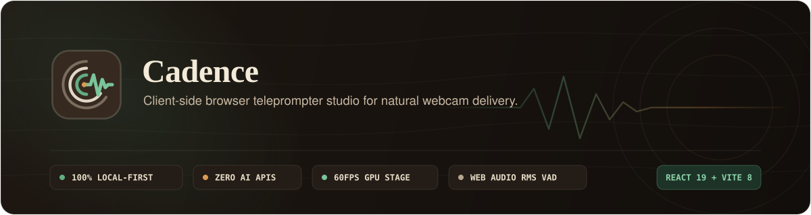
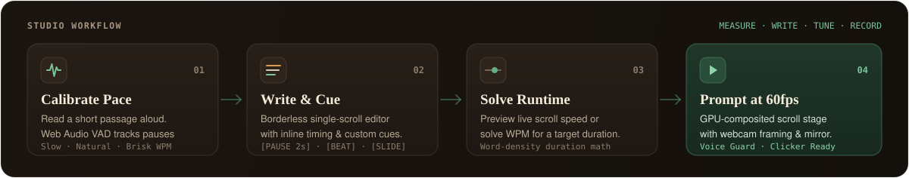
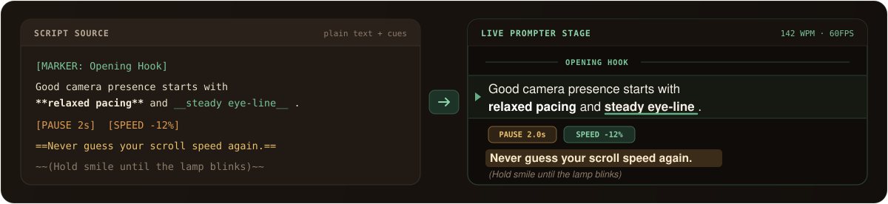

<p align="center">
  <picture>
    <source media="(prefers-color-scheme: dark)" srcset="./docs/assets/banner-dark.svg" />
    <source media="(prefers-color-scheme: light)" srcset="./docs/assets/banner-light.svg" />
    
  </picture>
</p>

<p align="center">
  <a href="#workflow">Workflow</a> &nbsp;·&nbsp;
  <a href="#features">Features</a> &nbsp;·&nbsp;
  <a href="#markup--cues">Markup &amp; Cues</a> &nbsp;·&nbsp;
  <a href="#shortcuts">Shortcuts</a> &nbsp;·&nbsp;
  <a href="#development">Development</a> &nbsp;·&nbsp;
  <a href="#documentation">Docs</a>
</p>

**Cadence** is a fast, 100% client-side browser teleprompter studio built for webcam recording, desk video production, and natural spoken delivery. It measures your actual speaking pace, helps you audition and tune your target WPM, provides a borderless script editor with programmable cues, and drives a 60fps GPU-composited teleprompter stage.

Zero AI APIs, zero accounts, and zero cloud uploads. Your scripts, camera preview, microphone voice detection, and preferences stay entirely inside your browser.

---

## Workflow

<p align="center">
  
</p>

---

## Features

| Area | What It Does |
| :--- | :--- |
| **Pace Calibration** | Read built-in or custom passages to measure baseline WPM. Optional Web Audio RMS voice activity detection (VAD) tracks breathing pauses and active speaking speed. Compare **Slow**, **Natural**, and **Brisk** tiers on a live audition strip before recording. |
| **Borderless Script Editor** | Single-scroll document canvas with icon-only formatting, clickable chapter jump pills, right-click context menu, and three switchable toolbar modes (**Compact**, **Floating on Select**, **Expanded Cue Bar**). Export as `.md`, `.txt`, clean plain text, or cued script. |
| **Programmable Custom Cues** | Create reusable inline tags like `[SLIDE]`, `[STORY]`, or `[B-ROLL]` in **Settings -> Cues** with custom colors, auto-pauses (0s to 8s), speed shifts, and synthesized Web Audio chimes. |
| **External LLM Prompt Builder** | Contains zero built-in AI. Generates a ready-to-copy prompt teaching any external LLM your Cadence cue syntax and custom cues, paired with a **Paste & Import** cleaner and previewer. |
| **60fps Prompter Stage** | Hardware-composited `translate3d` word-density scrolling, configurable inertia and speed ramps, local webcam eye-line framing, Voice Guard auto-pause, beam-splitter mirroring, and post-take pace summaries. |
| **Local Library & Themes** | Unlimited browser-stored scripts, `.txt`/`.md` import, portable `.json` workspace backup/restore, and matched **Dark Walnut** and **Sunlit Oak** studio themes. |

---

## Markup & Cues

<p align="center">
  
</p>

| Syntax | Prompter Stage Behavior |
| :--- | :--- |
| `**text**` / `__text__` | Bold emphasis / accent underline |
| `==text==` / `~~text~~` | Highlighted punchline / softened italic aside |
| `[PAUSE 2s]` | Auto-pauses scrolling for 2 seconds (`0.5s` to `30s`) |
| `[BEAT]` | Short rhythmic pause using your configured Beat duration |
| `[MARKER: Intro]` | Chapter divider and quick-jump section marker |
| `[SPEED 130]` / `[SPEED -15%]` / `[SPEED RESET]` | Smoothly ramps speed to target WPM, relative offset, or baseline |
| `[BEEP]` | Plays a gentle synthesized Web Audio tick |
| `[BREATHE]`, `[SMILE]`, `[SLOW]`, `[LOUD]`, `[PAUSE]` | Visual stage direction cue badge |
| `[CUSTOM_TAG]` | Executes any custom cue defined in **Settings -> Cues** |

For full syntax rules, duration math, and External LLM Prompt Builder usage, see [Markup & Cues Reference](./docs/markup-and-cues.md).

---

## Shortcuts

All stage controls can be remapped inside **Settings -> Keys** for Bluetooth clickers or foot pedals.

| Stage Action | Default Key | Editor Action | Shortcut |
| :--- | :--- | :--- | :--- |
| Play / Pause | `Space` | Bold selection | `Ctrl/Cmd + B` |
| Increase / Decrease Speed | `ArrowUp` / `ArrowDown` | Underline selection | `Ctrl/Cmd + U` |
| Next / Previous Marker | `PageDown` / `PageUp` | Highlight selection | `Ctrl/Cmd + Shift + H` |
| Reset to Start | `R` | Formatting & Cue Menu | `Right-Click` |
| Mirror Horizontal | `M` | | |
| Toggle Webcam / Fullscreen | `C` / `F` | | |
| Exit Prompter Stage | `Escape` | | |

---

## Development

**Requirements:** Node.js `>= 20`

```bash
# Install dependencies
npm install

# Start local dev server on http://localhost:3000
npm run dev

# Type-check with TypeScript
npm run lint

# Build production bundle to dist/
npm run build

# Preview production build locally
npm run preview
```

### Deploy to Vercel

Cadence ships preconfigured for Vercel via [`vercel.json`](./vercel.json) (Vite framework, SPA routing rewrites, camera/microphone `Permissions-Policy`, and immutable asset caching). Connect the repository in Vercel and deploy with default settings (`npm install` / `npm run build` / `dist`). No environment variables are required.

---

## Documentation

- [**Architecture & Engines**](./docs/architecture.md) : Client-side architecture diagram, directory layout, word-density scroll engine, and Web Audio RMS VAD design.
- [**Markup, Cues & Prompt Builder**](./docs/markup-and-cues.md) : Complete inline syntax reference, custom cue triggers, duration solver, and external LLM workflow.
- [**Deployment & Production**](./docs/deployment.md) : Vercel configuration, security and permissions headers, static asset/favicon manifest, and browser camera/mic notes.

---

## Contributing & License

Contributions are welcome. See [CONTRIBUTING.md](./CONTRIBUTING.md) for guidelines and [SECURITY.md](./SECURITY.md) for privacy and security details.

Licensed under the [MIT License](./LICENSE).

