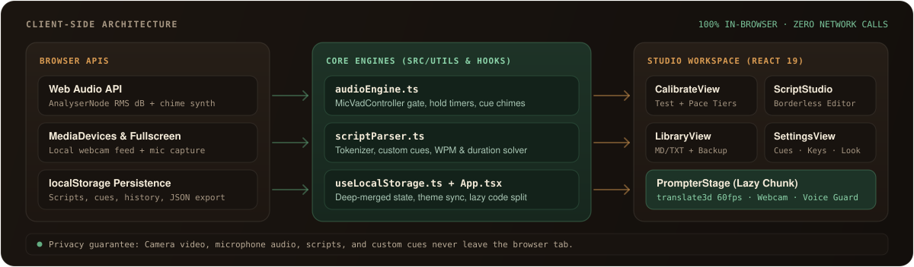

# Architecture & Engines

<p align="center">
  
</p>

Cadence is intentionally built as a zero-backend single-page application. Every feature, including microphone voice detection, cue tone synthesis, webcam eye-line framing, and script storage, runs locally in the browser tab using standard Web APIs.

---

## Directory Structure

```text
.
├── docs/
│   ├── assets/                    # Custom SVG banners and technical diagrams
│   ├── architecture.md            # System architecture and engine notes
│   ├── deployment.md              # Vercel and static production deployment guide
│   └── markup-and-cues.md         # Inline markup, custom cues, and LLM prompt builder
├── public/                        # Favicons, PWA manifest, OpenGraph image, robots.txt
├── src/
│   ├── App.tsx                    # Top bar, theme sync, workspace state, lazy route loading
│   ├── main.tsx                   # React 19 entry point
│   ├── index.css                  # Tailwind CSS v4 + Dark Walnut / Sunlit Oak design tokens
│   ├── types/
│   │   └── prompter.ts            # Shared TypeScript interfaces for scripts, cues, settings
│   ├── data/
│   │   └── defaults.ts            # Default themes, calibration passages, starter scripts, cues
│   ├── hooks/
│   │   └── useLocalStorage.ts     # Safe deep-merging localStorage persistence hook
│   ├── utils/
│   │   ├── audioEngine.ts         # RMS MicVadController and synthesized Web Audio chimes
│   │   └── scriptParser.ts        # Inline tokenizer, cue parser, WPM solver, LLM prompt builder
│   └── components/
│       ├── CalibrateView.tsx      # Reading test, live dB meter, Slow/Natural/Brisk audition
│       ├── ScriptStudioView.tsx   # Borderless auto-growing editor, context menu, exports
│       ├── LibraryView.tsx        # Script search, TXT/MD import, JSON workspace backup/restore
│       ├── SettingsView.tsx       # Full-page settings (Appearance, Cues, Voice, Shortcuts)
│       ├── PrompterStage.tsx      # 60fps GPU scroll stage, webcam PiP, Voice Guard, summary
│       ├── LlmPromptModal.tsx     # External LLM prompt generator and smart paste importer
│       ├── RichTextRenderer.tsx   # Shared stage and preview rich-text renderer
│       └── ui/
│           ├── CadenceLogo.tsx    # Adaptive dark/light tree-ring soundwave emblem
│           ├── ClayControls.tsx   # Tactile carved-wood buttons, cards, sliders, switches
│           └── ThemeWaveToggle.tsx# Sun/Moon theme switcher with expanding ring animation
├── index.html                     # Zero-FOUC theme bootstrapper, favicons, SEO & JSON-LD
├── vercel.json                    # Vercel framework, SPA rewrites, and security headers
└── vite.config.ts                 # Vite 8 + Rolldown chunk splitting configuration
```

---

## Key Technical Systems

### 1. Word-Density Scroll Engine (`PrompterStage.tsx`)
Naive pixel-per-second teleprompters drift whenever you change font size, line height, or column width. Cadence measures rendered paragraph heights against spoken word counts (`countSpokenWords`), converting target WPM into accurate pixel velocity per paragraph. Smooth scrolling runs inside a `requestAnimationFrame` loop writing directly to GPU-composited `transform: translate3d(0, -y, 0)` without triggering React re-renders per frame.

### 2. Non-AI Voice Activity Detection (`src/utils/audioEngine.ts`)
`MicVadController` connects the browser's `navigator.mediaDevices.getUserMedia({ audio: true })` stream to a Web Audio `AnalyserNode` (`fftSize = 1024`). On each animation frame it computes root-mean-square (RMS) amplitude in decibels:

- **Calibration Mode**: Counts breath pauses exceeding the silence hold threshold so Cadence reports both **gross WPM** (including pauses) and **active WPM** (speaking time only).
- **Voice Guard Mode**: Automatically pauses stage scrolling during silent moments and smoothly ramps back up when speech crosses the configured decibel gate.
- **Cue Chimes**: Synthesizes low, mid, and high soft sine chimes directly through `AudioContext` oscillators with zero external audio files.

### 3. Anchored Pace Calibration (`src/components/CalibrateView.tsx`)
Measured natural pace anchors the three audition tiers:
- **Slow**: ~12% slower than Natural (clamped to stay at least 10 WPM below Natural)
- **Natural**: Measured or anchored baseline pace
- **Brisk**: ~12% faster than Natural (clamped to stay at least 10 WPM above Natural)

Selecting Slow or Brisk updates the active workspace WPM immediately while keeping the Natural anchor intact so all three tiers remain distinct and selectable.

### 4. Local Persistence & Bundle Splitting
- **State Persistence**: `useLocalStorage` safely deep-merges stored JSON with default configs so schema additions never break older local profiles.
- **Zero-FOUC Theme Loading**: An inline bootstrap script in `index.html` applies the saved `dark` or `light` attribute before first paint.
- **Code Splitting**: Heavy views (`PrompterStage`, `SettingsView`, `LlmPromptModal`) are loaded via `React.lazy` and `Suspense`, and `vite.config.ts` separates `react-vendor` and `lucide-icons` chunks via Rolldown-compatible function `manualChunks`.
