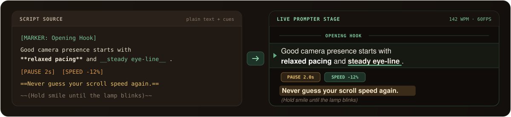

# Markup, Cues & External LLM Workflow

  

Cadence scripts are plain text enhanced with lightweight inline formatting and bracketed cue tags. Formatting stays readable in any text editor and exports cleanly to Markdown or stripped plain text.

---

## Text Styling

| Syntax | Editor Shortcut | Stage Appearance |
| :--- | :--- | :--- |
| `**bold phrase**` | `Ctrl/Cmd + B` | Bold emphasis |
| `__key phrase__` | `Ctrl/Cmd + U` | Accent underline |
| `==punchline==` | `Ctrl/Cmd + Shift + H` | Warm amber highlight |
| `~~aside note~~` | Right-click -> Soften | Dimmed italic aside (excluded from loud delivery emphasis) |

You can also select any text inside the Script editor and right-click to apply styling or insert cues, or switch to **Floating on Select** via the `•••` toolbar menu.

---

## Built-in Timing & Stage Cues

| Cue Tag | Behavior During Prompting |
| :--- | :--- |
| `[PAUSE 2s]` | Automatically pauses scrolling for the specified duration (`0.5s` to `30s`) with an on-stage countdown, then resumes smoothly. |
| `[BEAT]` | Triggers a short rhythmic pause using your configured Beat duration from **Settings**. |
| `[MARKER: Section Name]` | Renders a chapter divider and creates a jump target (`PageUp` / `PageDown` on stage, clickable pills in the Script editor). |
| `[SPEED 130]` | Smoothly eases scrolling speed to 130 WPM. |
| `[SPEED +10%]` / `[SPEED -15%]` | Smoothly shifts scrolling speed relative to your baseline WPM. |
| `[SPEED RESET]` | Smoothly returns scrolling speed to your baseline WPM. |
| `[BEEP]` | Plays a gentle synthesized Web Audio tick. |
| `[BREATHE]` `[SMILE]` `[SLOW]` `[LOUD]` `[PAUSE]` | Displays a clean visual stage direction badge without interrupting scroll timing. |

---

## Programmable Custom Cues

Open **Settings -> Cues** to define reusable inline cues tailored to your production workflow (for example `[SLIDE]`, `[STORY]`, `[SIP]`, `[B-ROLL]`, or `[DEMO]`).

Each custom cue supports:
1. **Tag Name**: Automatically normalized to uppercase bracket syntax (`[TAG_NAME]`).
2. **Color Swatch**: Pine, Amber, Terracotta, Slate, or Plum badge styling.
3. **Auto-Pause**: Optional timed hold from `0s` to `8s`.
4. **Speed Shift**: Keep current speed, apply a relative percentage offset, or reset to baseline.
5. **Audio Chime**: Optional Web Audio synthesized cue tone (`Off`, `Low`, `Mid`, or `High`) with instant preview.

Custom cues automatically synchronize across:
- The Script editor **+ Cue** dropdown and right-click context menu
- Total runtime and WPM duration calculations
- The External LLM Prompt Builder
- Live execution on the Prompter Stage

---

## External LLM Prompt Builder

Cadence includes zero built-in AI APIs. If you draft scripts with an external chat model of your choice, click **LLM** in the Script toolbar:

1. **Build Prompt**: Select your topic, tone, target runtime, and cue density. Cadence generates a tailored instruction block explaining its exact inline markup syntax and any custom cues you have configured.
2. **Copy & Draft**: Paste the prompt into any external LLM you prefer.
3. **Paste & Import**: Paste the response back into Cadence. The importer strips Markdown code fences, previews rendered cues and estimated duration, and lets you load it into the current script or save it as a new Library entry.
